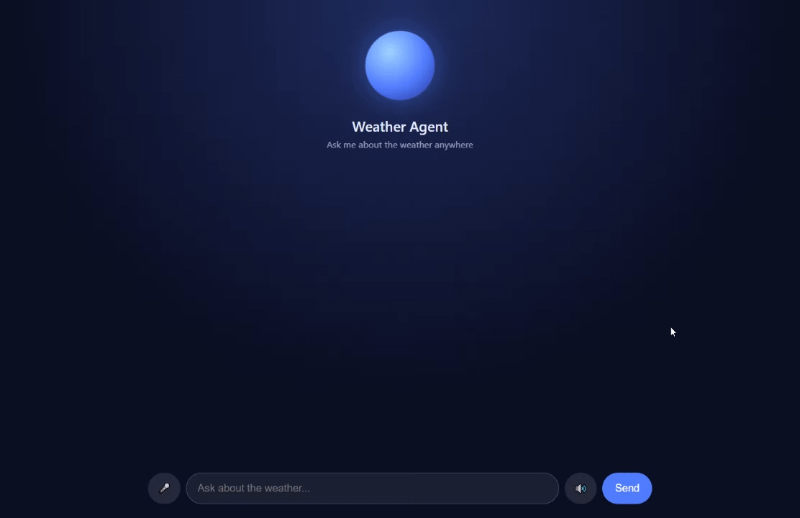

# Weather Agent MCP
## Screenshot

## What is it?
MCP Weather Agent. This project implements a Model Context Protocol (MCP) server in Python that exposes two tools, get_coordinates and
get_forecast, backed by the free Open-Meteo API. An AI agent connects to the server over stdio, discovers the available tools, and uses
a locally hosted open-source language model (Qwen 2.5 via Ollama) to decide when to call them. It runs a tool-calling loop, feeding the
real weather data back to the model until it can answer the user’s question in natural language, such as whether to bring an umbrella.
The project runs on Google Colab with no API keys or billing, and includes a web chat interface with an animated status orb, voice input
and optional spoken replies.

